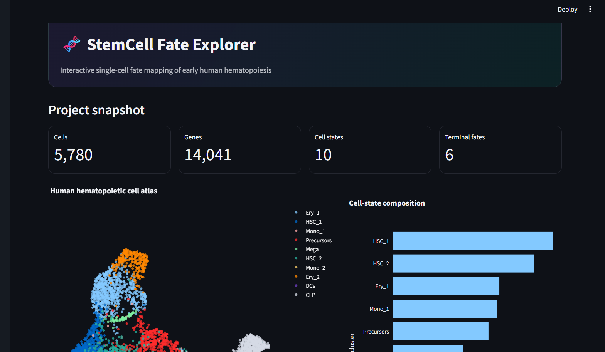
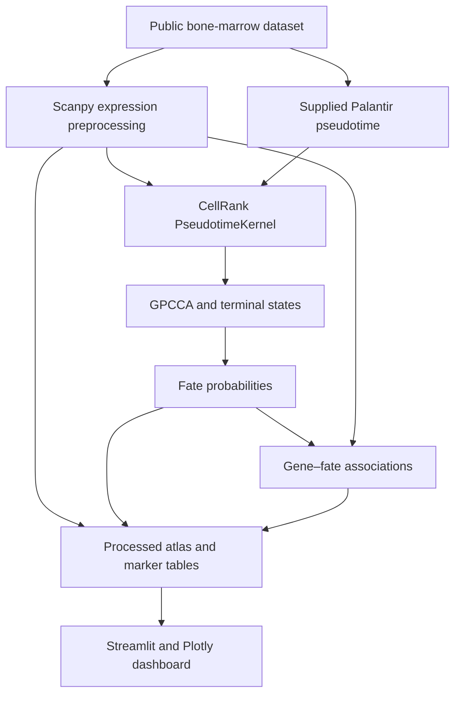
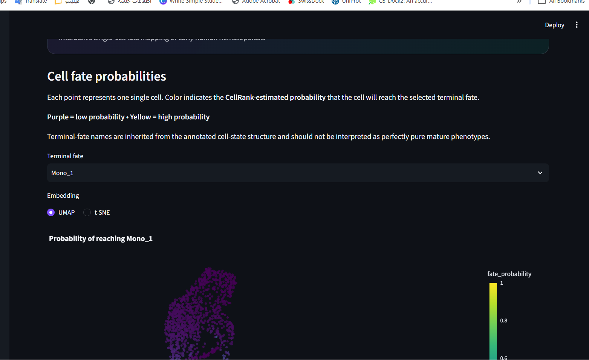
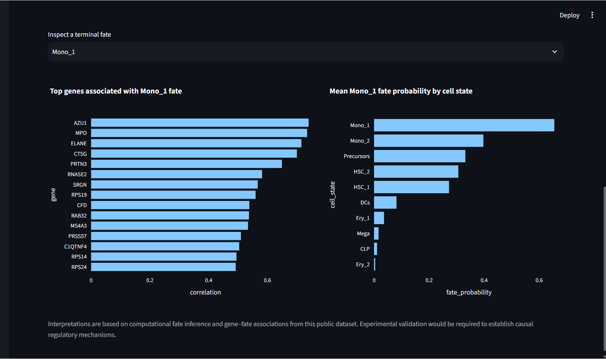

# StemCell Fate Explorer

**Computational exploration of human hematopoietic cell fate**

An interactive research application for exploring single-cell RNA-seq data, model-inferred lineage fates, and gene–fate associations using Scanpy, CellRank, GPCCA, Streamlit, and Plotly.

**Research and educational use only.** This project is not a clinical decision-support system. Inferred fates and associated genes are computational results, not experimentally validated cell outcomes or causal regulators.

## Demo

[Open the Streamlit dashboard](https://stemcell-fate-explorer-ga7tintmqwwbt8rghe5dqb.streamlit.app/)



## Scientific scope

The workflow asks how early human hematopoietic cells are organized along a pseudotime-directed transition model and which genes are associated with the resulting terminal-fate probabilities.

The analysis script loads CellRank's public **human bone-marrow** dataset, preprocesses expression with Scanpy, constructs a CellRank `PseudotimeKernel`, and uses GPCCA to infer macrostates and terminal fates. **Palantir pseudotime is supplied by the source dataset; this repository does not recompute Palantir.** The implemented transition model uses pseudotime rather than RNA velocity.

The Streamlit application reads committed processed outputs. It does not rerun the analysis when a user changes dashboard controls.

## Recorded dataset and analysis

The checked-in [run metadata](data/processed/project_meta.json) records the following:

| Item | Recorded value |
| --- | --- |
| Dataset | CellRank early human hematopoiesis, CD34+ bone marrow |
| Cells | 5,780 |
| Genes after filtering | 14,041 |
| Inferred terminal fates | 6 |
| Terminal-state labels | `Mono_1`, `DCs_1`, `Mega`, `DCs_2`, `Ery_2`, `CLP` |
| Pseudotime field | `palantir_pseudotime` |
| Kernel | `PseudotimeKernel` |
| Terminal selection | GPCCA `top_n` |
| Recorded environment | Python 3.12.3; CellRank 2.3.2; Scanpy 1.12.4; AnnData 0.12.19 |

These values describe the committed analysis outputs, not a new analysis run or an independent replication.

## Scientific architecture



The current preparation script filters genes detected in fewer than five cells, normalizes to 10,000 counts per cell, applies `log1p`, marks 3,000 highly variable genes, and constructs PCA, a neighbor graph, and UMAP. PCA, neighbors, and UMAP receive `random_state=0`. GPCCA uses 10 macrostates; the default terminal-state count is six. The default driver export retains the top 100 associations per lineage.

## Dashboard views

| View | Purpose |
| --- | --- |
| Overview | Recorded metrics, cell atlas, state composition, and provenance |
| Cell Atlas | UMAP, optional source t-SNE, pseudotime, and available differentiation potential |
| Fate Map | Model-inferred fate probabilities and summaries by annotated state |
| Putative Drivers | Gene–fate associations and downloadable CSV selections |
| Gene Explorer | Selected marker expression on UMAP and across supplied pseudotime |
| Biological Insights | Exploratory interpretation of lineage-associated patterns |
| Methods | Workflow, recorded environment, assumptions, and limitations |

### Fate map



### Exploratory biological interpretation



The interpretation view presents lineage-associated patterns from this dataset. Their biological plausibility is not independent validation, and dataset-derived labels should be read alongside expression patterns.

## Installation and running

### Dashboard from committed outputs

Run the following in a terminal with Git and Python 3.12 available:

```bash
git clone https://github.com/rezang-1378/stemcell-fate-explorer.git
cd stemcell-fate-explorer
python3.12 -m venv .venv
source .venv/bin/activate
python -m pip install -r requirements.txt
python -m streamlit run app.py
```

The environment activation command above is for Bash on Linux, macOS, or WSL. Open the local URL printed by Streamlit, normally `http://localhost:8501`.

The five dashboard input files are committed under `data/processed/`; the dashboard therefore does not require a new CellRank run. If any required input is absent, the app stops with an explanation rather than generating placeholder scientific results.

### Regenerate analysis outputs

With the environment activated and the repository root as the working directory:

```bash
python -m pip install -r requirements-analysis.txt
python scripts/prepare_data.py
```

The script loads the public source through `cellrank.datasets.bone_marrow()`, downloading it to `data/raw/bone_marrow.h5ad` when needed. It then writes to `data/processed/`, replacing the corresponding existing outputs.

For an isolated rerun that preserves the committed dashboard inputs:

```bash
python scripts/prepare_data.py --out-dir /tmp/stemcell-fate-explorer-rerun
```

The dashboard continues to read `data/processed/`; an alternate output directory is for comparison and is not selected automatically by the app.

## Repository map

| Path | Responsibility |
| --- | --- |
| `app.py` | Dashboard views and visualization |
| `scripts/prepare_data.py` | Public-data analysis and output generation |
| `src/data_io.py` | Required-file checks and output loading |
| `data/processed/` | Committed dashboard tables and recorded run metadata |
| `data/README.md` | Data layout and handling |
| `docs/scientific_scope.md` | Scope and interpretation limits |
| `assets/` | Existing dashboard screenshots |
| `requirements.txt` | Dashboard dependencies |
| `requirements-analysis.txt` | Analysis dependencies |
| `tests/test_repository_schema.py` | Required-path and README-term checks |
| `.github/workflows/python-ci.yml` | Syntax and repository-schema checks |

## Reproducibility and verification

The analysis dependencies pin CellRank and Scanpy, while several other packages use version ranges. The recorded metadata captures selected package versions and platform information; **a complete environment lockfile, source checksum, and full parameter manifest are not currently provided**. Fixed seeds in selected preprocessing steps do not establish bit-for-bit reproducibility across environments.

The existing repository checks are:

```bash
python -m compileall app.py scripts src tests
python tests/test_repository_schema.py
```

GitHub Actions runs these checks on pushes and pull requests. They check Python syntax, required paths, and selected README terms. They do **not** test numerical fate-probability validity, rerun the full scientific pipeline, validate biological findings, or establish clinical performance.

For a reproducibility comparison, retain the Git commit, actual installed package versions, source-data identity, analysis arguments, and exported outputs.

## Data policy

- Large raw data under `data/raw/` and `.h5ad` files are ignored by Git.
- Lightweight processed Parquet, CSV, and JSON outputs used by the dashboard are intentionally committed.
- The code license does not override upstream dataset terms, attribution requirements, or redistribution restrictions.
- Virtual environments, local Streamlit settings, and common caches are excluded by the existing `.gitignore`.

## Limitations

- Fate probabilities are conditional on the chosen transition model, supplied pseudotime, terminal states, and parameters. They are not experimentally measured outcome frequencies.
- Gene–fate association does not demonstrate causality or establish a therapeutic target.
- Pseudotime is not elapsed experimental time, and a two-dimensional embedding is a visualization rather than a direct lineage measurement.
- This repository explores one public hematopoietic dataset; generalization to other tissues, donors, diseases, or perturbations has not been established here.
- Independent biological validation and systematic parameter-sensitivity analyses are not demonstrated by the current repository checks.
- The interface is not a clinical diagnostic tool or a validated cell-therapy decision system.

See [scientific scope and limitations](docs/scientific_scope.md).

## Author and license

**Reza Negahban** — Computational Biology and Bioinformatics.

The repository already contains an [MIT License](LICENSE) for its code. Upstream data and software retain their own terms and attribution requirements.
